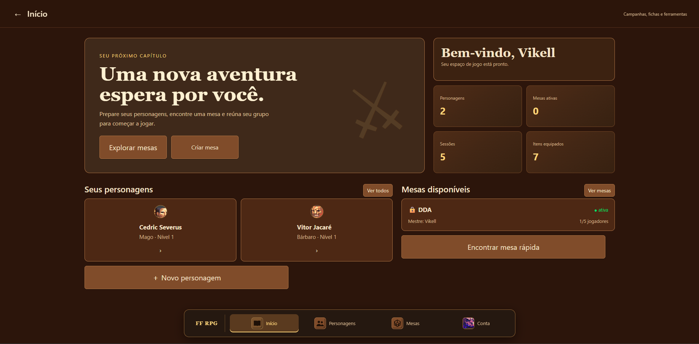
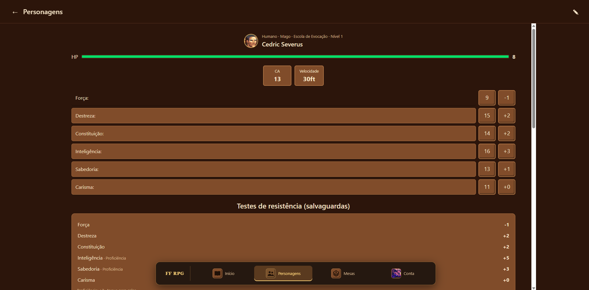
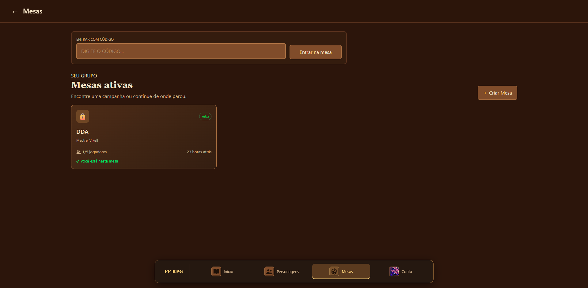
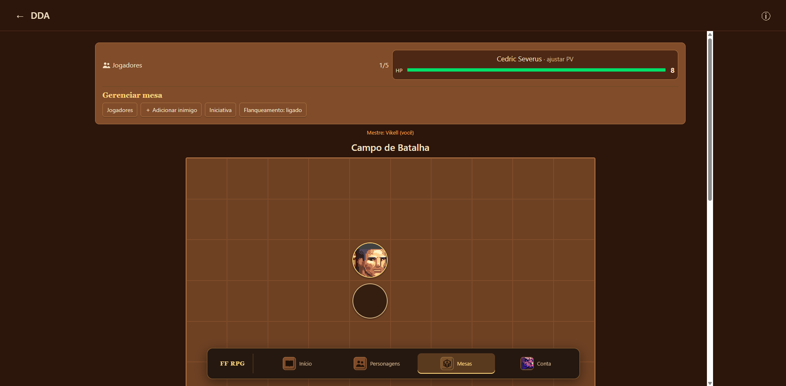
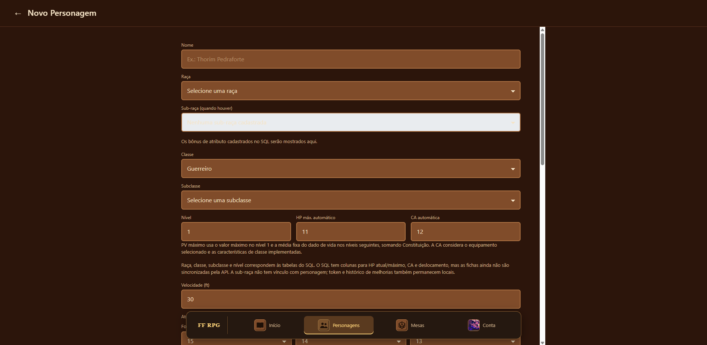
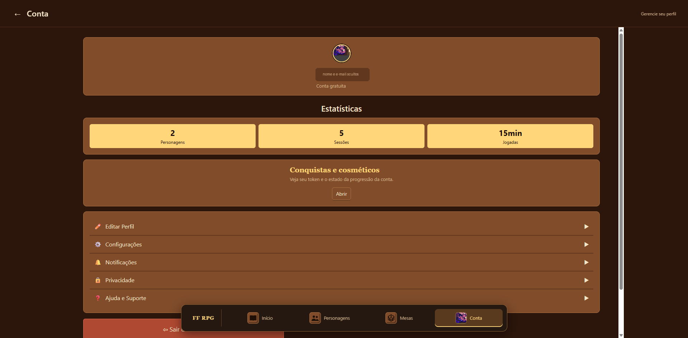

# ⚔ Fast Fantasy RPG

Aplicativo para jogar **RPG de mesa online**, de forma prática e gratuita, sem perder horas criando fichas. Projeto Integrador de ADS (startup *Fast Fantasy RPG*) com foco inicial em D&D 5e.

Este repositório contém o back-end em Java (MVC + DAO + JDBC), o banco de dados MySQL e a janela desktop em JavaFX.

## Screenshots

| Tela inicial | Ficha do personagem |
|---|---|
|  |  |

| Mesas | Sessão (campo de batalha) |
|---|---|
|  |  |

| Criação de personagem | Perfil |
|---|---|
|  |  |

## Integrantes

| Nome completo |
|---|
| José Valmori Krutsch Neto |

## Tabelas do CRUD (trabalho de POO)

O CRUD completo exigido no trabalho está nas tabelas **`mesa`** e **`personagem`**, relacionadas por `personagem.id_mesa → mesa.id_mesa` (uma mesa tem vários personagens).

| Operação | Mesa (`MesaDAO`) | Personagem (`PersonagemDAO`) |
|---|---|---|
| Criar | `inserir` | `inserir` |
| Ler | `listar` | `listar` |
| Atualizar | `atualizar` | `atualizar` / `atualizarCompleto` |
| Deletar | `deletar` | `deletar` |

Detalhes do relacionamento:
- `personagem.id_mesa` é opcional: um personagem pode existir sem mesa e entrar numa depois.
- Uma mesa que ainda tem personagens vinculados **não pode ser excluída** (o banco recusa pela chave estrangeira). Exclua ou mova os personagens antes.
- O banco também valida nível entre 1 e 20 e `0 ≤ hp_atual ≤ hp_maximo`, e um trigger registra as mudanças de PV em `log_personagem`.

O banco completo tem mais tabelas (usuário, mestre, player, raça, classe, magia, item, monstro, talento etc.), todas no script SQL.

## Arquitetura

```
src/
├── Model/        entidades de domínio (Mesa, Personagem, Usuario, Classe, Raca, ...)
├── DAO/          acesso a dados com JDBC: todo o SQL fica aqui (MesaDAO, PersonagemDAO, ...)
├── Controller/   RPGController: regras de negócio, intermedia a View/API e os DAOs
├── View/         MainView: janela desktop JavaFX que abre o front do app
├── Api/          API REST local em Spring Boot usada pelo front
├── Util/         ConnectionFactory (conexão MySQL) e SenhaUtil
└── main/resources/
    ├── application.properties
    └── schema.sql    tabelas auxiliares da API (sessão, estado do usuário, campanhas)
db/
└── ff_rpg-base.sql   script completo do banco MySQL (tabelas, views, triggers, permissões)
front/             front-end web (HTML/CSS/JS + index.php), usado pela janela JavaFX e hospedável em Docker
docs/
└── CONFIGURACAO.md   configuração detalhada (IntelliJ, variáveis, Docker e Railway)
pom.xml, Dockerfile, .env.example
```

- **Model:** classes de domínio e os DAOs (persistência).
- **DAO:** conexão e comandos SQL isolados das regras de negócio; erros de SQL viram exceções de tempo de execução com mensagem clara.
- **Controller:** `RPGController` valida e coordena as operações (cadastrar/atualizar/deletar mesa e personagem, entrar/sair da mesa, ajustar PV etc.).
- **View:** `MainView` (JavaFX) inicia o back-end e exibe o front do app.

## Tecnologias

- Java 17 (orientado a objetos), JDBC, Maven
- MySQL (banco `ff_rpg`) com `mysql-connector-j` 9.4.0
- Spring Boot 3.5.16 (API REST, `JdbcTemplate`, Spring Security Crypto/BCrypt) e Jackson
- JavaFX 17.0.14 (janela desktop com `WebView`)
- Front-end web responsivo (HTML, CSS, JavaScript, Bootstrap 5.3.9), servido localmente pelo PHP do XAMPP (pasta `front/`)
- Docker (Dockerfile do back-end) e Railway para hospedagem

## Como executar

Pré-requisitos: JDK 17, Maven (ou IntelliJ IDEA), MySQL e XAMPP (o PHP do XAMPP serve o front).

1. **Banco de dados:** inicie o MySQL, crie um banco vazio chamado `ff_rpg` e importe o script:
   ```bash
   mysql -u root -p ff_rpg < db/ff_rpg-base.sql
   ```
   Antes de importar, abra `db/ff_rpg-base.sql`, procure `TROQUE_A_SENHA` (final do arquivo) e coloque senhas suas para os usuários de banco `app_ff` e `relatorio_ff`; a senha do `app_ff` é a que vai em `DB_PASSWORD`.
   O script cria tabelas, views, triggers e esses dois usuários (`app_ff` para a aplicação e `relatorio_ff` para consulta). As tabelas extras da API (sessão, estado, campanhas) são criadas sozinhas na primeira inicialização.
2. **Variáveis de ambiente:** copie os valores de [`.env.example`](.env.example) para a configuração de execução (`DB_URL`, `DB_USER`, `DB_PASSWORD`, `PORT`, `APP_CORS_ORIGINS`). Não coloque a senha real no repositório.
3. **Front-end:** o front está na pasta [`front/`](front/). Copie-a para `C:\xampp\htdocs\fast_fantasy_rpg` (caminho padrão da janela) ou aponte `FAST_FANTASY_WEB_ROOT` para a pasta `front/` e `FAST_FANTASY_PHP` para o `php.exe` do XAMPP.
4. **Executar:** abra o projeto no IntelliJ, carregue o `pom.xml` como projeto Maven (baixa JavaFX e Spring na primeira vez) e execute `View.MainView`, ou use `mvn javafx:run`. A janela sobe a API em `127.0.0.1:8081` e o front em `127.0.0.1:8090`.

Passo a passo completo, incluindo Docker e Railway: [docs/CONFIGURACAO.md](docs/CONFIGURACAO.md).

## Transparência de IA

Usei inteligência artificial (Claude e Codex) como **apoio** durante o desenvolvimento. O código, o banco de dados e o front-end do projeto foram desenvolvidos por mim; a IA entrou nos pontos abaixo:

- **Estrutura:** sugestões de como organizar o projeto em MVC e DAO e de como separar as responsabilidades entre as camadas.
- **Ideias:** apoio para pensar em soluções e na modelagem do banco.
- **Revisão:** revisão de trechos de código e do script SQL, e apoio na correção de problemas.
- **Documentação e repositório:** apoio na organização do repositório no GitHub e na escrita do README.

As decisões do projeto, a implementação e a validação do funcionamento são minhas.
